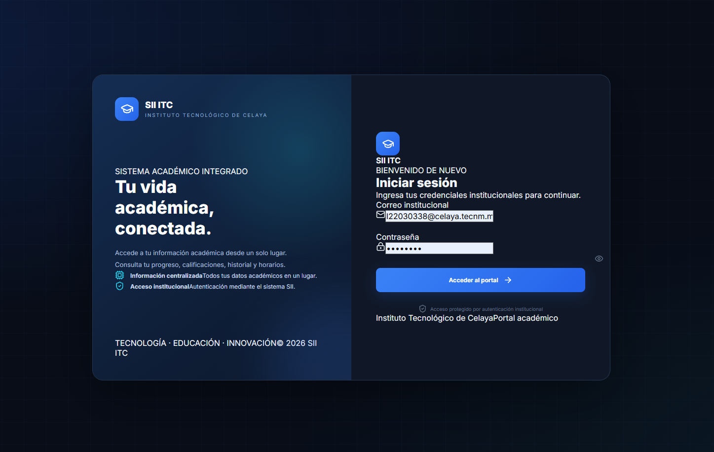
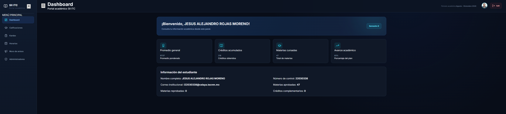
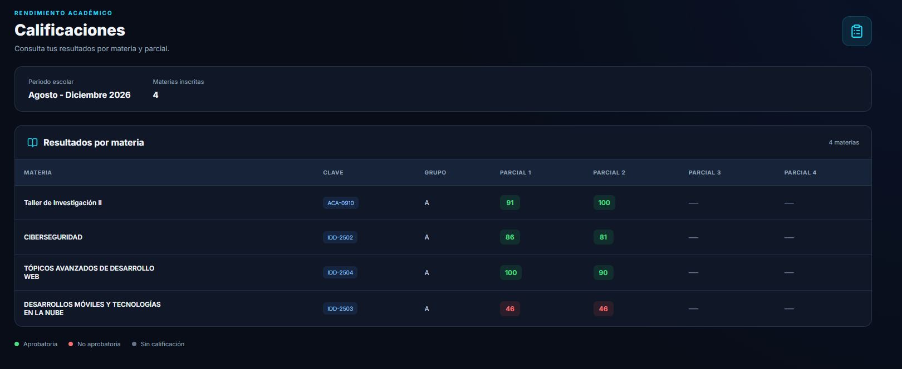
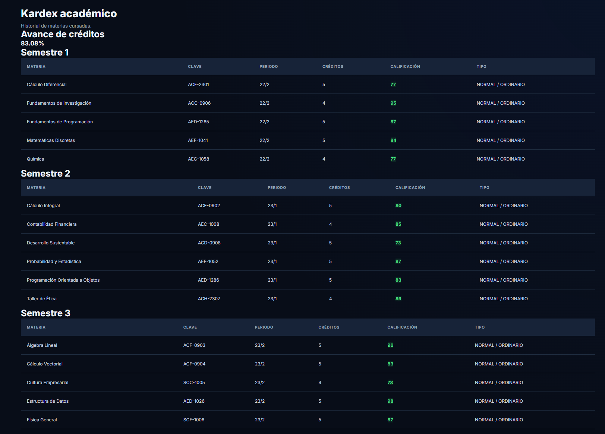
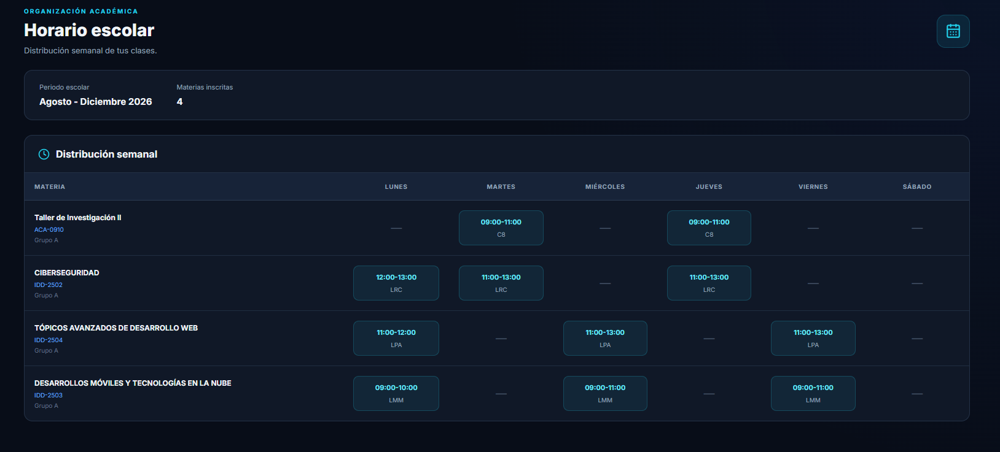
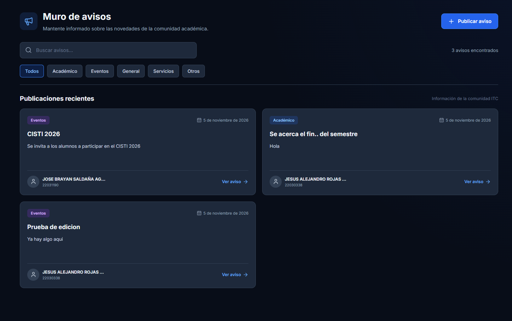
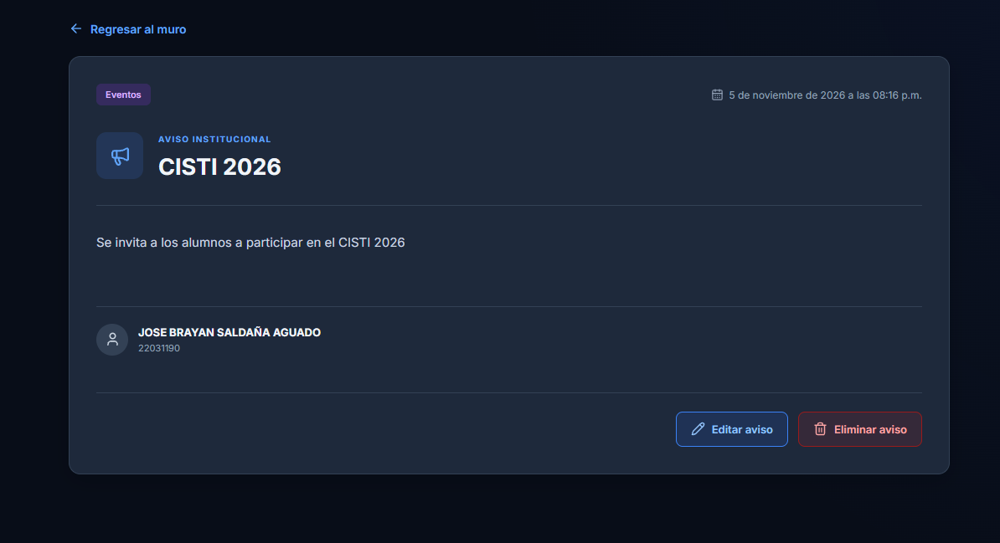
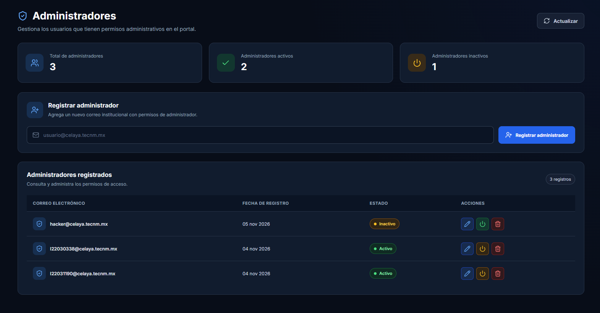

# 🎓 SII ITC – Portal Académico

Aplicación web desarrollada para el **Instituto Tecnológico de Celaya**, perteneciente al Tecnológico Nacional de México. Permite a los estudiantes consultar su información académica y ofrece herramientas administrativas para gestionar avisos y usuarios administradores.

El proyecto utiliza React y Vite para el frontend, conectado a un backend independiente mediante una API REST.

---

## 🚀 Tecnologías utilizadas

| Tecnología | Descripción |
|---|---|
| ⚛️ React | Biblioteca para construir interfaces de usuario. |
| ⚡ Vite | Herramienta de desarrollo y construcción. |
| JavaScript | Lenguaje principal de programación. |
| React Router DOM | Navegación y gestión de rutas. |
| Axios | Comunicación HTTP con el backend. |
| Lucide React | Biblioteca de iconos. |
| CSS3 | Estilos y diseño adaptable. |
| Node.js / Express | Backend independiente que proporciona los servicios API. |
| PostgreSQL | Base de datos utilizada por el backend. |

---

## 📋 Funcionalidades

### 📚 Módulo académico
- Dashboard con resumen de información académica.
- Consulta de calificaciones.
- Consulta de kardex académico.
- Consulta de horarios.

### 📢 Muro de avisos
- Consulta de avisos publicados.
- Visualización del contenido de cada aviso.
- Clasificación por categorías.
- Creación de avisos.
- Edición y eliminación de avisos por administradores.

### 🛡️ Administración
- Acceso exclusivo para usuarios administradores.
- Consulta de administradores registrados.
- Registro de nuevos administradores.
- Modificación de correos electrónicos.
- Activación y desactivación de administradores.
- Eliminación de administradores.

### 🔐 Autenticación y seguridad
- Inicio de sesión mediante credenciales institucionales.
- Verificación de sesión.
- Cierre de sesión.
- Protección de rutas privadas.
- Control de acceso según el rol del usuario.
- Manejo de sesiones mediante cookies.
- No se almacena el token institucional en `localStorage`.

---

## 📦 Requisitos previos

Antes de instalar el proyecto, asegúrate de contar con:

- [Node.js](https://nodejs.org/) (versión LTS recomendada).
- npm (incluido con Node.js).
- [Git](https://git-scm.com/).
- Backend del proyecto SII ITC configurado y en funcionamiento.

Para comprobar las versiones instaladas:

```bash
node -v
npm -v
git --version
```

---

## ⚙️ Instalación

### 1. Clonar el repositorio

```bash
git clone URL_DEL_REPOSITORIO
```

### 2. Entrar al directorio

```bash
cd sii-itc-frontend
```

### 3. Instalar dependencias

```bash
npm install
```

Este comando instala todas las dependencias definidas en `package.json`.

---

## 🔧 Configuración del entorno

Crea o verifica el archivo `.env.development` en la raíz del proyecto:

```env
VITE_API_URL=/api
```

### Configuración del proxy de Vite

El archivo `vite.config.js` debe contener la configuración del proxy para redirigir las peticiones hacia el backend:

```javascript
import { defineConfig } from "vite";
import react from "@vitejs/plugin-react";

export default defineConfig({
  plugins: [react()],
  server: {
    proxy: {
      "/api": {
        target: "http://localhost:3001",
        changeOrigin: true,
        secure: false,
      },
    },
  },
});
```

> **Importante:** El puerto configurado en `target` debe coincidir con el puerto en el que se ejecuta el backend.

Si el backend utiliza otro puerto o dirección, será necesario actualizar esta configuración.

---

## ▶️ Ejecución del proyecto

Una vez instaladas las dependencias y configurado el entorno, ejecuta:

```bash
npm run dev
```

Vite iniciará el servidor de desarrollo.

La aplicación estará disponible por defecto en:

**http://localhost:5173**

Para detener el servidor utiliza `Ctrl + C`.

> Recuerda que el backend debe estar ejecutándose para que las funcionalidades que consumen la API estén disponibles.

---

## 📜 Scripts disponibles

| Comando | Descripción |
|---|---|
| `npm install` | Instala las dependencias. |
| `npm run dev` | Inicia el servidor de desarrollo. |
| `npm run build` | Genera la versión de producción. |
| `npm run preview` | Previsualiza la versión compilada. |

---

## 🏗️ Arquitectura del proyecto

El frontend se comunica con un backend independiente, que se encarga de procesar las solicitudes, gestionar las sesiones, validar permisos y comunicarse con los servicios académicos y la base de datos.

```text
                 ┌───────────────────┐
                 │      Usuario      │
                 └─────────┬─────────┘
                           │
                           ▼
                 ┌───────────────────┐
                 │   Frontend React  │
                 │       + Vite      │
                 └─────────┬─────────┘
                           │
                     Peticiones HTTP
                           │
                           ▼
                 ┌───────────────────┐
                 │ Backend Node.js   │
                 │     + Express     │
                 └─────────┬─────────┘
                           │
                  ┌────────┴────────┐
                  │                 │
                  ▼                 ▼
          ┌──────────────┐  ┌──────────────┐
          │   API SII    │  │ PostgreSQL   │
          │     ITC      │  │              │
          └──────────────┘  └──────────────┘
```

El frontend no consume directamente los servicios académicos del SII. Todas las solicitudes se realizan a través del backend del proyecto.

---

## 📁 Estructura del proyecto

```text
sii-itc-frontend/
│
├── public/
│
├── src/
│   ├── assets/
│   │
│   ├── components/
│   │   ├── Layout.jsx
│   │   ├── Sidebar.jsx
│   │   ├── ProtectedRoute.jsx
│   │   └── ...
│   │
│   ├── context/
│   │   └── AuthContext.jsx
│   │
│   ├── pages/
│   │   ├── Dashboard.jsx
│   │   ├── Calificaciones.jsx
│   │   ├── Kardex.jsx
│   │   ├── Horarios.jsx
│   │   │
│   │   ├── avisos/
│   │   │   ├── Avisos.jsx
│   │   │   ├── CrearAviso.jsx
│   │   │   ├── VerAviso.jsx
│   │   │   └── EditarAviso.jsx
│   │   │
│   │   └── admins/
│   │       ├── Admins.jsx
│   │       └── Admins.css
│   │
│   ├── services/
│   │   ├── api.js
│   │   ├── avisos.service.js
│   │   └── admins.service.js
│   │
│   ├── App.jsx
│   └── main.jsx
│
├── .env.development
├── .gitignore
├── index.html
├── package.json
├── package-lock.json
├── vite.config.js
└── README.md
```

*La estructura puede variar conforme evolucione el proyecto.*

---

## 🔌 Comunicación con el backend

Las solicitudes HTTP se centralizan mediante Axios en:

```text
src/services/api.js
```

Los servicios específicos se organizan en archivos independientes:

- `avisos.service.js`: operaciones relacionadas con el muro de avisos.
- `admins.service.js`: operaciones relacionadas con la administración de usuarios.

Las peticiones utilizan el prefijo `/api`, que Vite redirige al servidor backend durante el desarrollo.

---

## 🎨 Diseño de la interfaz

La aplicación cuenta con una interfaz de estilo tecnológico y académico que incluye:

- Tema oscuro.
- Panel de navegación lateral.
- Diseño adaptable a diferentes tamaños de pantalla.
- Tarjetas informativas.
- Tablas para presentar información académica.
- Iconografía mediante Lucide React.

---

## 🔨 Construcción para producción

Para generar los archivos optimizados de producción:

```bash
npm run build
```

Los archivos generados se almacenarán en el directorio:

```text
dist/
```

Para previsualizar la compilación:

```bash
npm run preview
```

---

## ⚠️ Consideraciones importantes

1. El frontend necesita que el backend esté funcionando para utilizar sus funcionalidades.
2. Las credenciales institucionales deben introducirse directamente en el formulario de inicio de sesión.
3. No se deben almacenar contraseñas ni tokens institucionales en el almacenamiento local del navegador.
4. Los permisos administrativos deben validarse también desde el backend.
5. No se deben subir archivos `.env` con secretos o credenciales al repositorio.
6. Cada desarrollador debe configurar su propio entorno local para ejecutar el proyecto.

---

## 👨‍💻 Desarrollo académico

Este proyecto forma parte del desarrollo académico de una aplicación web para el:

**Instituto Tecnológico de Celaya**  
**Tecnológico Nacional de México**

### SII ITC – Sistema de Información Académica

---

## 🖥️ Capturas de pantalla

A continuación se muestran las principales interfaces del sistema SII ITC.

### 🔐 Inicio de sesión



### 📊 Dashboard



### 🎓 Calificaciones



### 📚 Kardex académico



### 📅 Horarios



### 📢 Muro de avisos



### 📄 Detalle de aviso



### 🛡️ Administración de usuarios


